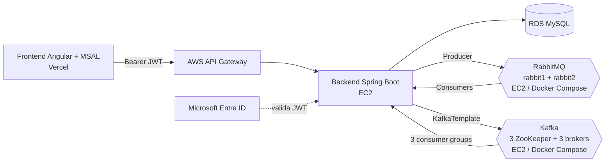
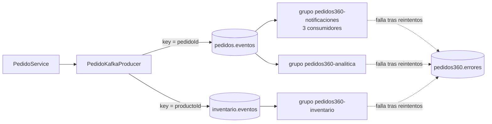

# Pedidos360 — Backend (Spring Boot + RabbitMQ + Kafka)

API de pedidos para el ramo **DSY1107 Desarrollo Cloud Native I** (Duoc UC).
Backend Spring Boot 3.5 / Java 21, protegido con **Microsoft Entra ID** (JWT),
con mensajería asíncrona sobre **RabbitMQ en clúster de 2 nodos** y un flujo de
eventos de dominio sobre **Apache Kafka (3 ZooKeeper + 3 brokers)**.

## Arquitectura



- **Autenticación:** Entra ID emite el access token; el backend lo valida como OAuth2 Resource Server.
- **Autorización:** los endpoints `/api/admin/**`, `/api/kafka-admin/**` y `/api/analitica/**` exigen el rol `Admin` (`@PreAuthorize`).
- **Persistencia:** RDS MySQL en AWS; H2 en memoria con el perfil `local`.
- **RabbitMQ y Kafka conviven:** RabbitMQ reparte tareas (notificar, cocina, despacho) con ACK manual y DLQ;
  Kafka guarda el flujo de eventos como un registro que se puede releer (retención, offsets, consumer groups).

## Mensajería (RabbitMQ)

Toda la topología está en `messaging/RabbitMQConfig.java`; el negocio (`PedidoService`)
solo publica eventos a través de `PedidoEventoProducer`.

| Elemento | Detalle |
|---|---|
| Direct exchange | `pedidos360.direct.exchange` |
| Colas principales | `notificaciones.queue`, `cocina.queue`, `despacho.queue` |
| Routing keys | `pedido.creado`, `pedido.aceptado`, `pedido.despachado` (y `pedido.cancelado` hacia auditoría) |
| Topic exchange | `pedidos360.topic.exchange` → `auditoria.queue` con patrón `pedido.*` |
| Reintentos | NACK → `pedidos360.dlx` → `<dominio>.retry.queue` (TTL 5 s) → vuelve a la cola principal |
| DLQ | `notificaciones.dlq`, `cocina.dlq`, `despacho.dlq` |
| Intentos | 3 en total (el inicial + 2 reintentos); luego el mensaje va a su DLQ y se registra en el log |
| ACK | Manual (`acknowledge-mode=manual`), en `messaging/Consumers.java` |

Flujo de un pedido: `PedidoService` → Producer → exchange → cola → `@RabbitListener` → ACK.
Fallo controlado: excepción → NACK → retry (TTL) → … → DLQ + log.

### Microservicio administrador

Prefijo `/api/admin` (rol `Admin`). Lógica en `admin/RabbitAdminService.java`,
validación de entradas en los DTO (nombres vacíos o tipos inválidos responden `400`).

| Método | Ruta | Respuesta |
|---|---|---|
| POST | `/api/admin/queues` | 201 |
| DELETE | `/api/admin/queues/{nombre}` | 204 |
| POST | `/api/admin/exchanges` (`direct`, `topic`, `fanout`) | 201 |
| DELETE | `/api/admin/exchanges/{nombre}` | 204 |
| POST | `/api/admin/bindings` | 201 |

Colección de pruebas: `postman/Pedidos360 - Admin RabbitMQ.postman_collection.json`
(variables `baseUrl` y `token`; el token **no** se guarda en el repo).

## Eventos (Apache Kafka)

### Clúster

`docker-compose.kafka.yml` levanta **3 nodos ZooKeeper** (ensemble con quórum), **3 brokers Kafka**
y **Kafka UI** (http://localhost:8090; el 8080 es del backend). Cada broker tiene dos listeners:
`INTERNAL` (`kafkaN:29092`, tráfico entre brokers y Kafka UI) y `EXTERNAL`
(`localhost:9092/9093/9094`, para el backend). Los tópicos no se crean solos
(`auto.create.topics.enable=false`).

```bash
docker compose -f docker-compose.kafka.yml up -d
docker compose -f docker-compose.kafka.yml ps

# Ensemble ZooKeeper: uno "leader" y dos "follower"
docker exec pedidos360-zk1 bash -c "echo srvr | nc localhost 2181 | grep Mode"
# Brokers registrados: debe responder [1, 2, 3]
docker exec pedidos360-zk1 zookeeper-shell localhost:2181 ls /brokers/ids
```

### Tópicos

| Tópico | Contenido | Key | Particiones / réplicas |
|---|---|---|---|
| `pedidos.eventos` | cada cambio de estado de un pedido (`PedidoEventoKafka`) | id del pedido | 3 / 3 |
| `inventario.eventos` | descuentos de stock (`InventarioEventoKafka`) | id del producto | 3 / 3 |
| `pedidos360.errores` | mensajes que agotaron sus reintentos (`ErrorEventoKafka`); equivalente a la DLQ de RabbitMQ, no es un tópico de negocio | key original | 3 / 3 |

- **Key:** todos los eventos de un mismo pedido (o producto) caen en la misma partición y se leen en orden.
- **Replicación:** factor 3 y `min.insync.replicas=2`; el productor usa `acks=all` + idempotencia.
- **Retención:** 7 días por defecto (`retention.ms=604800000`, propiedad `pedidos360.kafka.retention-ms`),
  modificable en caliente (API o script).
- Se declaran como beans `NewTopic` en `kafka/KafkaTopicsConfig.java`; Spring los crea al arrancar si no existen.

### Flujo



- **Productor** (`kafka/PedidoKafkaProducer.java`): arma el DTO, elige la key y envía con `KafkaTemplate`.
  Si Kafka no responde, se registra el error y el pedido continúa (el negocio no depende de Kafka).
  Cada envío imprime `[KAFKA][PRODUCER] topico=… key=… particion=… offset=…`.
- **Serialización:** key `String`; value JSON (`JsonSerializer` / `JsonDeserializer` envuelto en
  `ErrorHandlingDeserializer`). Los DTO están en `kafka/dto/` (records).
- **Consumer groups:** cada grupo recibe todos los mensajes del tópico que escucha; dentro de un grupo
  las particiones se reparten entre sus consumidores.

| Grupo | Tópico | Consumidores | Qué hace |
|---|---|---|---|
| `pedidos360-notificaciones` | `pedidos.eventos` | 3 (uno por partición) | arma el aviso al cliente según el tipo de evento |
| `pedidos360-analitica` | `pedidos.eventos` | 1 | cuenta eventos, pedidos aceptados e ingresos; ignora duplicados por `eventId` |
| `pedidos360-inventario` | `inventario.eventos` | 1 | último stock por producto y alerta de stock bajo (< 10) |

### Errores y reintentos

`kafka/KafkaErrorConfig.java` define un `DefaultErrorHandler` para todos los `@KafkaListener`:

1. Si el listener lanza una excepción, se reintenta el mismo mensaje con espera creciente
   (1 s, 2 s, 4 s; 3 reintentos, 4 intentos en total).
2. Al agotarse, el mensaje se publica en `pedidos360.errores` con tópico, partición, offset, key,
   valor y causa del error, y el consumidor sigue con el siguiente (no queda bloqueado).
3. `EventoInvalidoException` y los mensajes que no se pueden deserializar no se reintentan: van directo a errores.

Para demostrarlo sin tocar código, arrancar el backend con `PEDIDOS360_KAFKA_SIMULAR_FALLO=true`:
los eventos `PEDIDO_ACEPTADO` fallan siempre en notificaciones.

### Administración por API

Prefijo `/api/kafka-admin` (rol `Admin`), lógica en `kafka/KafkaAdminService.java` (cliente `AdminClient`).

| Método | Ruta | Respuesta |
|---|---|---|
| GET | `/api/kafka-admin/topics` | lista de tópicos |
| GET | `/api/kafka-admin/topics/{nombre}` | particiones, líder, réplicas, ISR, configuración |
| POST | `/api/kafka-admin/topics` | 201 |
| PUT | `/api/kafka-admin/topics/{nombre}/retention` | cambia `retention.ms` |
| DELETE | `/api/kafka-admin/topics/{nombre}` | 204 (los tópicos del sistema están protegidos) |
| GET | `/api/kafka-admin/groups` | consumer groups, estado y miembros |
| GET | `/api/kafka-admin/groups/{grupo}/lag` | offset confirmado, fin del log y lag por partición |
| GET | `/api/analitica/pedidos`, `/api/analitica/inventario` | lo que calcularon los consumidores |

Entradas inválidas responden `400`; si Kafka no está disponible, `503`.

Pruebas dentro del proyecto: `http/pedidos-kafka.http` (extensión **REST Client** de VS Code).
El token se lee de `http/.env` (copiar `http/.env.example`; no se sube a GitHub).
También hay una colección Postman: `postman/Pedidos360 - Pedidos y Kafka.postman_collection.json`.

### Administración por línea de comandos

`scripts/kafka.sh` (Linux / AWS / Git Bash) y `scripts/kafka.ps1` (PowerShell) usan las herramientas
de los contenedores de Kafka, así que funcionan igual en local y en AWS:

```bash
./scripts/kafka.sh topics-crear                         # crea los 3 tópicos (3 particiones, RF 3)
./scripts/kafka.sh topics-describir pedidos.eventos     # líder, réplicas e ISR por partición
./scripts/kafka.sh topics-retencion pedidos.eventos 3600000
./scripts/kafka.sh mensajes pedidos.eventos 10          # clave, partición y offset de cada mensaje
./scripts/kafka.sh grupos-listar
./scripts/kafka.sh grupos-lag pedidos360-notificaciones # offsets, fin del log y lag
./scripts/kafka.sh grupos-reset pedidos360-analitica pedidos.eventos --ejecutar   # backend detenido
```

En PowerShell: `.\scripts\kafka.ps1 grupos-lag pedidos360-notificaciones` (y `-Ejecutar` en vez de `--ejecutar`).

## Ejecución local

Requisitos: Java 21, Maven 3.9+, Docker.

```bash
# RabbitMQ de 1 nodo (guest/guest, solo local)
docker compose up -d

# Backend con H2 y RabbitMQ local
mvn spring-boot:run "-Dspring-boot.run.profiles=local"
```

Management UI: http://localhost:15672

Con el clúster completo (RabbitMQ de 2 nodos + Kafka), levantar ambos y arrancar el backend:

```bash
cp .env.example .env            # y cambiar los valores
docker compose -f docker-compose.cluster.yml up -d
docker compose -f docker-compose.kafka.yml up -d
mvn spring-boot:run "-Dspring-boot.run.profiles=local"
```

Con el perfil `local` la base H2 está en memoria: cada reinicio la deja vacía (hay que volver a crear el producto).

## Clúster de 2 nodos (Docker Compose)

`docker-compose.cluster.yml` levanta `rabbit@rabbit1` y `rabbit@rabbit2`
(AMQP 5672/5673, UI 15672/15673). Las credenciales van en un `.env`
(copiar de `.env.example`; el `.env` **no se sube** a GitHub).

```bash
cp .env.example .env            # y cambiar los valores
docker compose -f docker-compose.cluster.yml up -d

# Unir rabbit2 a rabbit1 (solo la primera vez)
docker exec pedidos360-rabbit2 rabbitmqctl stop_app
docker exec pedidos360-rabbit2 rabbitmqctl reset
docker exec pedidos360-rabbit2 rabbitmqctl join_cluster rabbit@rabbit1
docker exec pedidos360-rabbit2 rabbitmqctl start_app
docker exec pedidos360-rabbit1 rabbitmqctl cluster_status
```

Política de retención, **solo en las 3 colas principales** (nunca en `*.retry` ni `*.dlq`,
para no perder mensajes fallidos antes de diagnosticarlos):

```bash
docker exec pedidos360-rabbit1 rabbitmqctl set_policy --apply-to queues pedidos360-principales \
  '^(notificaciones|cocina|despacho)\.queue$' '{"message-ttl":120000,"max-length":200}'
docker exec pedidos360-rabbit1 rabbitmqctl list_policies
```

> Un clúster no es replicación ni alta disponibilidad: las colas clásicas viven en un solo nodo.
> Esto demuestra la agrupación de nodos y el monitoreo, no tolerancia garantizada a fallos.

## Monitoreo

`monitor/monitor_queues.py` consulta la Management API (solo librería estándar de Python)
y muestra **Ready / Unacked / Consumers** por cola, con alertas:

- una `*.dlq` con Ready > 0;
- cualquier cola con Ready ≥ umbral (`--umbral-ready`, por defecto 10);
- una cola principal con Consumers = 0 y Ready > 0.

```bash
export RABBITMQ_USER=...  RABBITMQ_PASS=...   # PowerShell: $env:RABBITMQ_USER="..."
python monitor/monitor_queues.py --una-vez
python monitor/monitor_queues.py --intervalo 15 --umbral-ready 10
```

Los umbrales son de demostración y deben ajustarse al tráfico real.
Para Kafka, el monitoreo es el lag por consumer group (`/api/kafka-admin/groups/{grupo}/lag`,
`scripts/kafka.sh grupos-lag <grupo>` o la pestaña Consumers de Kafka UI).

## Configuración por variables de entorno

| Variable | Uso | Por defecto |
|---|---|---|
| `RABBITMQ_HOST` / `RABBITMQ_PORT` | Broker | `localhost` / `5672` |
| `RABBITMQ_USER` / `RABBITMQ_PASS` | Credenciales del broker | `guest` / `guest` (solo local) |
| `DB_URL` / `DB_PASSWORD` | Base de datos (perfil AWS) | — |
| `PEDIDOS360_SIMULAR_FALLO_NOTIFICACIONES` | `true` hace fallar a notificaciones (RabbitMQ) para demostrar reintentos y DLQ | `false` |
| `KAFKA_BOOTSTRAP_SERVERS` | Brokers que usa el backend | `localhost:9092,localhost:9093,localhost:9094` |
| `KAFKA_EXTERNAL_HOST` | Dirección que anuncian los brokers (en el `.env` del compose de Kafka; en AWS, IP privada de la EC2 de Kafka) | `localhost` |
| `KAFKA_GROUP_ID` | Grupo por defecto (cada listener define el suyo) | `pedidos360-default` |
| `PEDIDOS360_KAFKA_SIMULAR_FALLO` | `true` hace fallar a notificaciones (Kafka) para demostrar reintentos y tópico de errores | `false` |

## Despliegue en AWS

- **RabbitMQ:** una EC2 con Docker Compose (`docker-compose.cluster.yml`).
  Security Group: 15672 solo desde la IP del administrador; 5672 solo desde la IP privada del backend.
- **Kafka:** una EC2 con al menos 4 GB de memoria (por ejemplo `t2.medium`) con Docker Compose
  (`docker-compose.kafka.yml`) y `KAFKA_EXTERNAL_HOST` = IP privada de esa EC2.
  Security Group: 9092-9094 solo desde la IP privada del backend; 8090 (Kafka UI) solo desde la IP del administrador.
- **Backend:** otra EC2 que ejecuta el `.jar` apuntando a la IP privada de RabbitMQ, a la de Kafka
  (`KAFKA_BOOTSTRAP_SERVERS=<ip>:9092,<ip>:9093,<ip>:9094`) y a RDS.

## Seguridad

Este repositorio no contiene contraseñas, tokens ni cookies: se entregan por variables de
entorno o por un `.env` ignorado por git (`.gitignore`). Kafka y Kafka UI no llevan autenticación
en este laboratorio: en AWS se limitan por Security Group.
