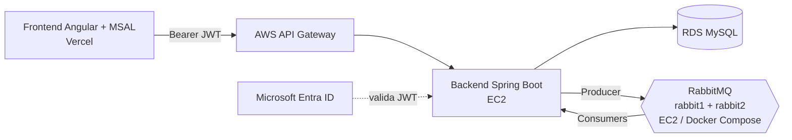

# Pedidos360 — Backend (Spring Boot + RabbitMQ)

API de pedidos para el ramo **DSY1107 Desarrollo Cloud Native I** (Duoc UC).
Backend Spring Boot 3.5 / Java 21, protegido con **Microsoft Entra ID** (JWT),
con mensajería asíncrona sobre **RabbitMQ en clúster de 2 nodos**.

## Arquitectura



- **Autenticación:** Entra ID emite el access token; el backend lo valida como OAuth2 Resource Server.
- **Autorización:** los endpoints `/api/admin/**` exigen el rol `Admin` (`@PreAuthorize`).
- **Persistencia:** RDS MySQL en AWS; H2 en memoria con el perfil `local`.

## Mensajería (RabbitMQ)

Toda la topología está en `messaging/RabbitMQConfig.java`; el negocio (`PedidoService`)
solo publica eventos a través de `PedidoEventoProducer`.

| Elemento | Detalle |
|---|---|
| Direct exchange | `pedidos360.direct.exchange` |
| Colas principales | `notificaciones.queue`, `cocina.queue`, `despacho.queue` |
| Routing keys | `pedido.creado`, `pedido.aceptado`, `pedido.despachado` (y `pedido.cancelado` hacia auditoría) |
| Topic exchange | `pedidos360.topic.exchange` → `auditoria.queue` con patrón `pedido.*` |
| Reintentos | NACK → `pedidos360.dlx` → `<dominio>.retry.queue` (TTL 5 s) → vuelve a la cola principal |
| DLQ | `notificaciones.dlq`, `cocina.dlq`, `despacho.dlq` |
| Intentos | 3 en total (el inicial + 2 reintentos); luego el mensaje va a su DLQ y se registra en el log |
| ACK | Manual (`acknowledge-mode=manual`), en `messaging/Consumers.java` |

Flujo de un pedido: `PedidoService` → Producer → exchange → cola → `@RabbitListener` → ACK.
Fallo controlado: excepción → NACK → retry (TTL) → … → DLQ + log.

### Microservicio administrador

Prefijo `/api/admin` (rol `Admin`). Lógica en `admin/RabbitAdminService.java`,
validación de entradas en los DTO (nombres vacíos o tipos inválidos responden `400`).

| Método | Ruta | Respuesta |
|---|---|---|
| POST | `/api/admin/queues` | 201 |
| DELETE | `/api/admin/queues/{nombre}` | 204 |
| POST | `/api/admin/exchanges` (`direct`, `topic`, `fanout`) | 201 |
| DELETE | `/api/admin/exchanges/{nombre}` | 204 |
| POST | `/api/admin/bindings` | 201 |

Colección de pruebas: `postman/Pedidos360-Admin.postman_collection.json`
(variables `baseUrl` y `token`; el token **no** se guarda en el repo).

## Ejecución local

Requisitos: Java 21, Maven 3.9+, Docker.

```bash
# RabbitMQ de 1 nodo (guest/guest, solo local)
docker compose up -d

# Backend con H2 y RabbitMQ local
mvn spring-boot:run "-Dspring-boot.run.profiles=local"
```

Management UI: http://localhost:15672

## Clúster de 2 nodos (Docker Compose)

`docker-compose.cluster.yml` levanta `rabbit@rabbit1` y `rabbit@rabbit2`
(AMQP 5672/5673, UI 15672/15673). Las credenciales van en un `.env`
(copiar de `.env.example`; el `.env` **no se sube** a GitHub).

```bash
cp .env.example .env            # y cambiar los valores
docker compose -f docker-compose.cluster.yml up -d

# Unir rabbit2 a rabbit1 (solo la primera vez)
docker exec pedidos360-rabbit2 rabbitmqctl stop_app
docker exec pedidos360-rabbit2 rabbitmqctl reset
docker exec pedidos360-rabbit2 rabbitmqctl join_cluster rabbit@rabbit1
docker exec pedidos360-rabbit2 rabbitmqctl start_app
docker exec pedidos360-rabbit1 rabbitmqctl cluster_status
```

Política de retención, **solo en las 3 colas principales** (nunca en `*.retry` ni `*.dlq`,
para no perder mensajes fallidos antes de diagnosticarlos):

```bash
docker exec pedidos360-rabbit1 rabbitmqctl set_policy --apply-to queues pedidos360-principales \
  '^(notificaciones|cocina|despacho)\.queue$' '{"message-ttl":120000,"max-length":200}'
docker exec pedidos360-rabbit1 rabbitmqctl list_policies
```

> Un clúster no es replicación ni alta disponibilidad: las colas clásicas viven en un solo nodo.
> Esto demuestra la agrupación de nodos y el monitoreo, no tolerancia garantizada a fallos.

## Monitoreo

`monitor/monitor_queues.py` consulta la Management API (solo librería estándar de Python)
y muestra **Ready / Unacked / Consumers** por cola, con alertas:

- una `*.dlq` con Ready > 0;
- cualquier cola con Ready ≥ umbral (`--umbral-ready`, por defecto 10);
- una cola principal con Consumers = 0 y Ready > 0.

```bash
export RABBITMQ_USER=...  RABBITMQ_PASS=...   # PowerShell: $env:RABBITMQ_USER="..."
python monitor/monitor_queues.py --una-vez
python monitor/monitor_queues.py --intervalo 15 --umbral-ready 10
```

Los umbrales son de demostración y deben ajustarse al tráfico real.

## Configuración por variables de entorno

| Variable | Uso | Por defecto |
|---|---|---|
| `RABBITMQ_HOST` / `RABBITMQ_PORT` | Broker | `localhost` / `5672` |
| `RABBITMQ_USER` / `RABBITMQ_PASS` | Credenciales del broker | `guest` / `guest` (solo local) |
| `DB_URL` / `DB_PASSWORD` | Base de datos (perfil AWS) | — |
| `PEDIDOS360_SIMULAR_FALLO_NOTIFICACIONES` | `true` hace fallar a notificaciones para demostrar reintentos y DLQ | `false` |

## Despliegue en AWS

- **RabbitMQ:** una EC2 con Docker Compose (`docker-compose.cluster.yml`).
  Security Group: 15672 solo desde la IP del administrador; 5672 solo desde la IP privada del backend.
- **Backend:** otra EC2 que ejecuta el `.jar` apuntando a la IP privada de RabbitMQ y a RDS.

## Seguridad

Este repositorio no contiene contraseñas, tokens ni cookies: se entregan por variables de
entorno o por un `.env` ignorado por git (`.gitignore`).
